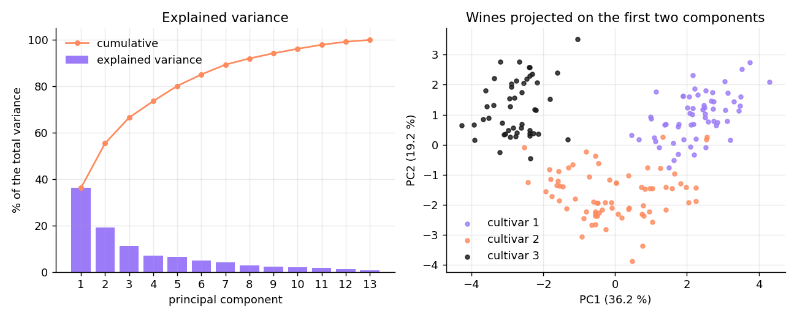
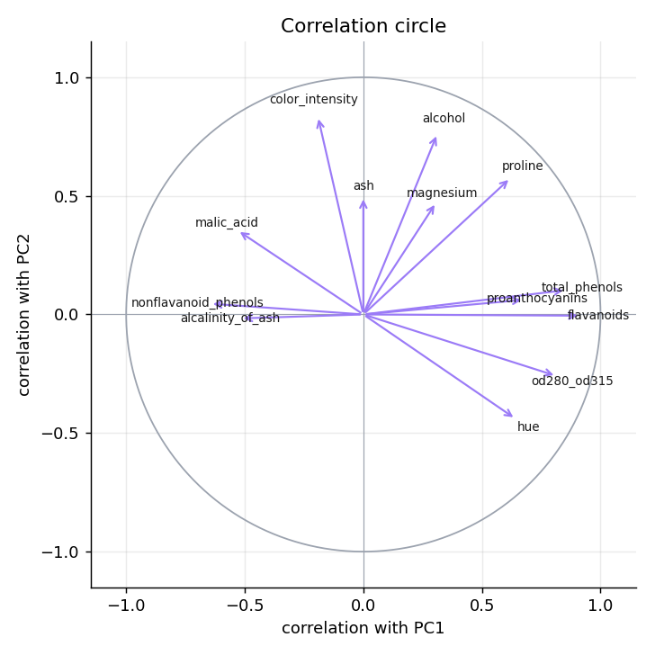
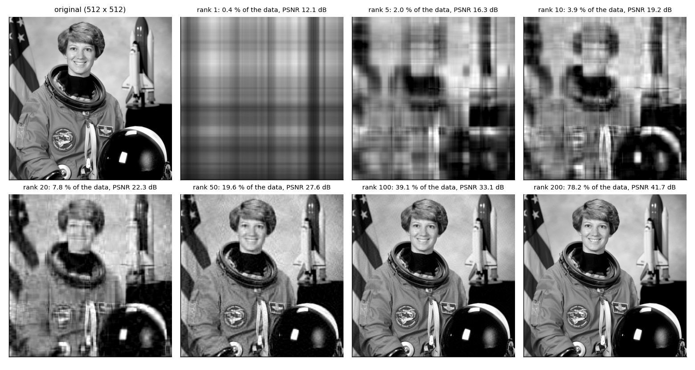
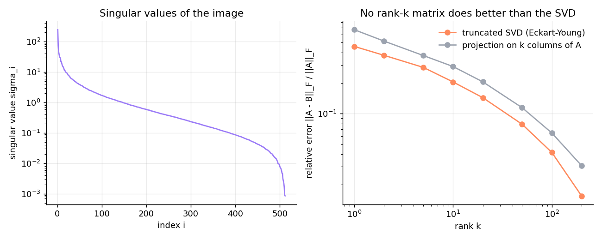
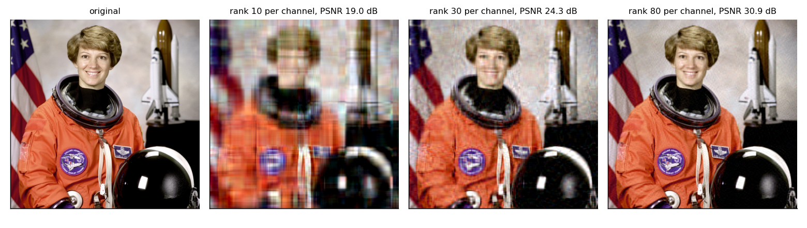

# ACP et décomposition en valeurs singulières (SVD)


*English summary: [README_EN.md](README_EN.md)* · **Rapport complet (LaTeX) : [report/rapport.pdf](report/rapport.pdf)**

Projet personnel en Python (NumPy, Matplotlib). J'ai programmé moi-même, **sans utiliser `numpy.linalg.eig` ni `numpy.linalg.svd`**, deux algorithmes de rotations de Jacobi :

- la **diagonalisation d'une matrice symétrique** (méthode de Jacobi cyclique) ;
- la **décomposition en valeurs singulières** (méthode de Jacobi « à un côté », vectorisée pour traiter une image $512 \times 512$ en environ 17 s).

Je les utilise pour :

1. faire l'**ACP du jeu de données Wine** par deux voies, la diagonalisation de la matrice de covariance puis la SVD, et montrer qu'elles coïncident ;
2. **compresser une image** par approximation de rang faible et vérifier le **théorème d'Eckart–Young** sur l'erreur de reconstruction.

NumPy sert ensuite uniquement à **vérifier** les résultats : écart relatif de $7{,}6 \times 10^{-14}$ sur les valeurs singulières de l'image.

## 1. ACP du jeu de données Wine

178 vins de trois cépages, 13 mesures chimiques réduites.

| Axe | $\lambda_j$ (covariance + Jacobi) | $\sigma_j^2/(n-1)$ (SVD) | Variance expliquée | Cumul |
|---|---|---|---|---|
| CP1 | 4,7059 | 4,7059 | 36,2 % | 36,2 % |
| CP2 | 2,4970 | 2,4970 | 19,2 % | 55,4 % |
| CP3 | 1,4461 | 1,4461 | 11,1 % | 66,5 % |
| CP4 | 0,9190 | 0,9190 | 7,1 % | 73,6 % |
| CP5 | 0,8532 | 0,8532 | 6,6 % | 80,2 % |

Les deux voies coïncident à $3 \times 10^{-15}$ près, et avec `scikit-learn` à $10^{-14}$ près. Le critère de Kaiser retient 3 composantes.



Le premier axe oppose les vins riches en composés phénoliques (flavanoïdes, phénols totaux) aux autres ; le deuxième est porté par l'intensité de la couleur, l'alcool et la proline. **Sans connaître les cépages**, l'ACP les sépare : une règle du centre le plus proche dans le premier plan classe correctement **97,2 %** des vins (validation en laissant chaque vin de côté).



**Il faut réduire les données** : sans cela, la première composante explique 99,8 % de la variance et n'est presque que la variable `proline`, dont les valeurs sont de l'ordre de 1 000.

### Pourquoi la voie SVD est plus sûre

Diagonaliser $X^\top X$ élève le conditionnement au carré. Sur la matrice de Läuchli, dont la plus petite valeur singulière vaut $\epsilon$ :

| $\epsilon$ | Erreur, valeurs propres de $A^\top A$ | Erreur, SVD de $A$ |
|---|---|---|
| $10^{-4}$ | $5{,}7 \times 10^{-9}$ | 0 |
| $10^{-6}$ | $9{,}0 \times 10^{-7}$ | 0 |
| $10^{-8}$ | 100 % (valeur perdue) | 0 |

## 2. Compression d'image et théorème d'Eckart–Young

L'approximation tronquée $A_k = \sum_{i \le k} \sigma_i u_i v_i^\top$ est la meilleure matrice de rang $k$, avec une erreur connue d'avance : $\lVert A - A_k\rVert_F = \big(\sum_{i>k}\sigma_i^2\big)^{1/2}$ et $\lVert A - A_k\rVert_2 = \sigma_{k+1}$.



| Rang $k$ | Données stockées | Erreur mesurée | Formule d'Eckart–Young | PSNR |
|---|---|---|---|---|
| 10 | 3,9 % | 0,2053 | 0,2053 | 19,2 dB |
| 50 | 19,6 % | 0,0787 | 0,0787 | 27,6 dB |
| 100 | 39,1 % | 0,0415 | 0,0415 | 33,1 dB |
| 200 | 78,2 % | 0,0155 | 0,0155 | 41,7 dB |

L'erreur mesurée et la formule théorique coïncident à $3{,}5 \times 10^{-15}$ près, et aucune autre approximation de rang $k$ testée ne fait mieux :





## Structure

```
pcasvd/
  linalg.py        Jacobi (valeurs propres), SVD de Jacobi à un côté, approximation de rang k
  pca.py           ACP par la covariance et par la SVD
  compression.py   erreur relative, formule d'Eckart–Young, taux de stockage, PSNR
  data.py          chargement de Wine et de l'image
experiments/run_all.py  toutes les expériences : figures/, results.md et report/generated.tex
report/rapport.tex      rapport LaTeX (les valeurs numériques sont générées automatiquement)
tests/                  16 tests (orthogonalité, A V = V Λ, A = U Σ Vᵀ, accord des deux ACP, Eckart–Young…)
```

## Utilisation

```bash
pip install -r requirements.txt
python experiments/run_all.py       # environ 1 minute (4 SVD d'images 512 × 512)
pytest
cd report && pdflatex rapport.tex
```

## Données

- **Wine** : S. Aeberhard et M. Forina, UCI Machine Learning Repository, licence CC BY 4.0.
- **Image** : photographie de l'astronaute Eileen Collins, NASA (domaine public), fournie avec scikit-image.

## Auteur

**Yassine Abderrezak Dache**, licence d'informatique (USTHB) · [GitHub @yassinedache](https://github.com/yassinedache) · Licence MIT
